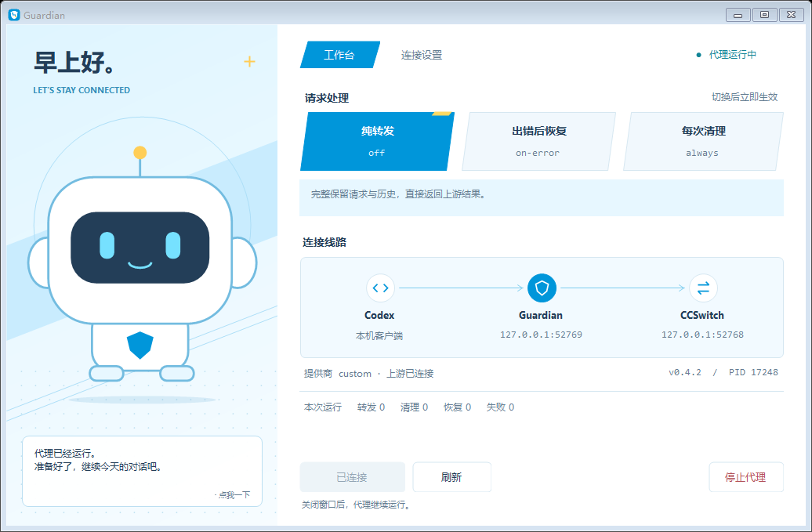

# Responses Guardian

用于 Codex 与 CCSwitch 的本地 Responses API 兼容代理，提供 Windows 桌面管理器和浏览器控制面板。

**桌面管理器 1.6.3 · 代理 0.4.2 · MIT License**

```text
Codex → Responses Guardian（127.0.0.1:15722）→ CCSwitch（127.0.0.1:15721）→ 上游
```

Guardian 可以原样转发请求，或在遇到特定历史密文、resource mismatch 错误时清理不可迁移的引用后重试。模式支持即时切换，设置会保存供下次启动使用。



## 快速开始

运行环境：Windows 10/11 x64、.NET Framework 4.8、Windows PowerShell 5.1。预编译包不需要 Go，也不需要额外 GUI 运行时。

1. 下载并完整解压 [Windows 发行包](https://github.com/Catofone/responses-guardian-public/releases/latest)。
2. 启动 CCSwitch，启用本地代理，并确认 Codex 当前提供商已配置为通过 CCSwitch 访问上游。默认上游地址是 `http://127.0.0.1:15721`。
3. 双击应用文件夹中的 **`Guardian.exe`**。首次启动使用 `off`；已有模式记录时沿用保存的模式。代理已运行时连接已有实例。
4. 首次把 Codex 接入 Guardian 后，完全退出并重新打开 Codex，让新进程读取新的 `base_url`。之后打开管理器、查看状态和切换模式无需重启 Codex。

请保留完整应用文件夹，快捷方式应指向其中的 `Guardian.exe`。关闭管理窗口会保留后台代理；需要退出代理时，在关闭 Codex 后使用“停止代理”。

`启动Guardian.cmd` 优先打开桌面管理器；尚未构建桌面程序时，保留启动代理并打开浏览器面板的入口。启动失败会保留错误提示。

## 运行模式

| 模式 | 行为 |
| --- | --- |
| `off` | 原样转发，不检查、不清理，也不因历史错误重试。桌面首次启动默认使用此模式。 |
| `on-error` | 先原样发送；命中特定历史密文或 resource mismatch 错误时清理并重试一次。 |
| `always` | 每个 Responses 请求在第一次发送前就清理历史中不可迁移的内容。 |

每个请求在开始时固定自己的模式，正在输出的流会继续完成，模式切换作用于后续请求。

`always` 会持续删除 reasoning、compaction、item reference、旧 response/conversation 引用及服务器 item ID。它保留明文消息、工具调用对和可读 reasoning summary，但会损失加密推理连续性，以及只存在于 compaction 密文中的早期上下文。

也可以使用脚本切换：

```powershell
.\scripts\set-mode.ps1 off
.\scripts\set-mode.ps1 on-error
.\scripts\set-mode.ps1 always
```

## 桌面管理器

- 独立的工作台和连接设置页面，支持原生窗口缩放、最大化、最小化及恢复。
- 查看连接状态、切换模式、修改端口与上游、选择 Codex 配置文件、设置提供商及重试次数。
- 未连接时可验证并保存下次启动设置，再点击“连接代理”。
- 设置支持最近 100 步撤销/重做；Ctrl+Z 撤销，Ctrl+Y 或 Ctrl+Shift+Z 重做，保存前只修改草稿。
- 定时刷新保留未保存草稿和未解决的错误，操作期间拦截重复点击。
- 1.6.3 在模式切换及后台刷新时保留其他按钮的外观，并在模式区域显示切换进度。

详细行为与验证范围见 [桌面管理器说明](docs/DESKTOP.zh-CN.md)，版本变化见 [更新记录](CHANGELOG.md)。

| 设置 | 生效方式 |
| --- | --- |
| 模式 | 立即作用于后续请求 |
| 请求及流重试次数 | 写入选定提供商的 Codex 配置，Codex 重启后读取 |
| 监听地址、上游、提供商、配置路径 | 保存为下次启动设置，代理重新启动后应用 |

管理器兼容已运行的 0.4.1 代理。离线配置验证使用 0.4.2，或使用校验通过的 0.4.2 暂存程序进行只检查操作，不会为验证而启动第二个代理或切换路由。

## 浏览器面板与脚本

代理启动后可运行：

```powershell
.\scripts\open-panel.ps1
.\scripts\status.ps1
```

默认面板为 `http://127.0.0.1:15722/__responses_guardian/panel`。监听支持 IPv4、localhost 和 IPv6 回环地址；脚本使用活动实例的实际地址。

手动启动并指定模式：

```powershell
powershell -NoProfile -ExecutionPolicy Bypass -File .\scripts\start-ccswitch.ps1 -Mode on-error
```

脚本初次启动会读取当前 Codex 提供商。提供商 ID 对应配置中的 `[model_providers.<id>]`，不等同于 CCSwitch 内的供应商账号名。

## 配置、重试与更新

`runtime/settings.json` 保存下次启动设置，`runtime/instance.json` 记录活动实例，`runtime/mode.json` 保存模式。配置文件路径、提供商、路由及写入条件会在保存前验证，校验失败时保留原设置。

面板支持将 `request_max_retries` 和 `stream_max_retries` 设置为 0–100。初始迁移保留已有配置；缺少设置时示例默认值为 20。Guardian 不额外叠加一套 429 重试。永久配额或账单限制需要在上游处理。

Guardian 只维护选定提供商的本地路由与已保存的重试字段。首次修改配置会创建备份；文件写入使用临时文件与替换，并检查并发修改。启动失败时撤回本次路由变更，同时保留其他程序已经修改的凭据及其他字段。

更新程序或更改代理监听地址时，先完全关闭 Codex，保持 CCSwitch 代理运行，再执行：

```powershell
.\scripts\activate-update.ps1
```

该命令使用校验通过的 `.next.exe`，保留上一版程序，并沿用当前或已保存的模式。成功后重新打开 Codex。

停止代理：

```powershell
.\scripts\stop-ccswitch.ps1
```

停止操作会恢复活动实例使用的 CCSwitch 路由。Codex 仍运行或存在活动连接时，正常停止操作会拒绝执行。

## 恢复范围与边界

- 仅针对指定的历史密文解密、验证、解析失败，以及 OpenAI resource mismatch 错误触发恢复。
- 保留明文消息、图片与文件引用，以及成对的工具调用和结果；可读 reasoning summary 会转为普通上下文。
- 普通 400、500、429 和已经开始输出的流不触发这套历史清理；恢复最多重试一次。
- 只允许监听和转发到回环地址，不跟随上游重定向。
- 不记录请求正文、Authorization、API key、工具输出或 reasoning summary。
- 支持 zstd 请求解码，解压结果受 64 MiB 上限保护。
- 不修改 CCSwitch 数据库，不自动注册开机启动。

## 皮肤与公开预览

默认小助手由程序绘制，公开图标来自项目内的原创 SVG。普通启动可读取 `%LOCALAPPDATA%\ResponsesGuardian\skins\companion.png` 作为可选本机皮肤，缺失或解码失败时使用默认小助手。

外部皮肤由使用者自行提供，不嵌入 EXE，也不随源码和发行包分发。需要以默认外观截图时使用 `Guardian.exe --public-preview`，该模式强制使用默认图案，并与普通管理窗口独立运行。素材说明见 [ASSETS.md](desktop/assets/ASSETS.md)。

## 从源码构建与验证

需要 Go 1.25+；桌面部分使用 .NET Framework 4.8 自带的 C# 编译器，兼容 C# 5。

```powershell
New-Item -ItemType Directory -Force .\artifacts\build | Out-Null
.\scripts\build-desktop.ps1 -OutputPath .\artifacts\build\Guardian.exe
go test -count=1 ./...
go vet ./...
```

只验证桌面界面时可运行 `go test -count=1 -run TestWindowsDesktopManagerUI -v ./cmd/responses-guardian`。测试使用临时配置、临时端口、模拟上游及默认素材；DPI 回放和离屏绘制检查不代表真实多显示器测试。

生成可分享的完整应用目录、Windows 包和源码包：

```powershell
.\scripts\package-public.ps1 -OutputDirectory .\artifacts\release
```

公开文件名单与版本定义在 `scripts/public-files.json`。打包会检查文档、版本及内嵌资源，并只从白名单导出的源码构建。维护及发布说明见 [PUBLISHING.zh-CN.md](docs/PUBLISHING.zh-CN.md)。

## 许可证

项目源码、默认小助手及原创图标使用 [MIT License](LICENSE)。第三方组件保留原许可，见 [THIRD-PARTY-NOTICES.md](THIRD-PARTY-NOTICES.md)。个人提供的外部皮肤不适用项目对原创素材的授权。
